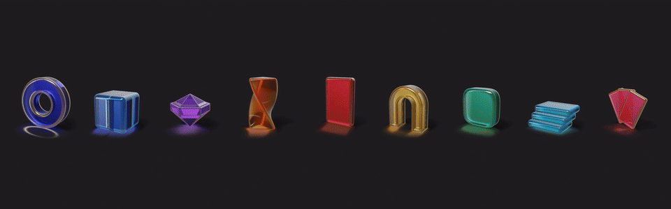
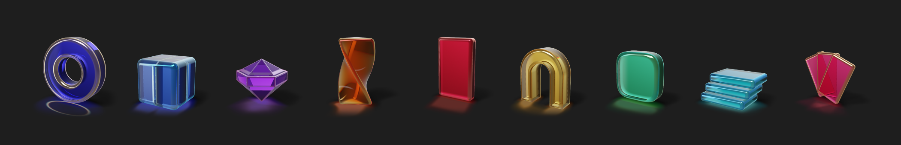

# caustic

solid glass icons that cast light.



[full reel](media/reel.mp4)

nine little objects made of colored glass. they refract, their edges shift color as they turn, and each one throws its own caustic on the table. hover one and it turns toward your cursor on springs.

it's one webgl shader, no images, no dependencies.



`ring` `grid` `gem` `twist` `slab` `arch` `tile` `stack` `fan`

## use

```html
<script type="module" src="https://cdn.jsdelivr.net/gh/zqkra/caustic/src/caustic.js"></script>

<caustic-icon name="gem" size="96"></caustic-icon>
```

or `npm i github:zqkra/caustic` and

```js
import "caustic-icons"
```

react:

```jsx
import { CausticIcon } from "caustic-icons/react"

<CausticIcon name="twist" size={56} state="thinking" />
```

## attributes

| | |
|---|---|
| `name` | ring, grid, gem, twist, slab, arch, tile, stack, fan |
| `size` | css px. looks best at 16, 18, 32, 56, 72, 96 or bigger |
| `state` | idle, thinking, speaking, done |
| `selected` | rests in a lit pose |
| `hover-host` | css selector of the parent that should trigger hover, like a whole row |

every icon shares one webgl context. idle icons are drawn once and then they're just pixels, so a page full of them costs nothing. only the one you hover, or the ones thinking or speaking, render live. reduced motion is respected.

## no js

`png/` has all nine at 16 to 256 px, 1x and 2x, transparent.

## the shader

`shader/caustic.frag.glsl` is the whole thing in one file. uniforms are documented at the top, use it anywhere glsl es 3.0 runs.

## render

```sh
node tools/export.mjs gem --size 512 --scale 2                       # png
node tools/export.mjs fan --size 256 --state thinking --seconds 6    # mp4
```

needs chromium and ffmpeg. point `CHROME` at your chromium if it isn't found.

## license

MIT. third party bits are credited in [NOTICE](NOTICE).
